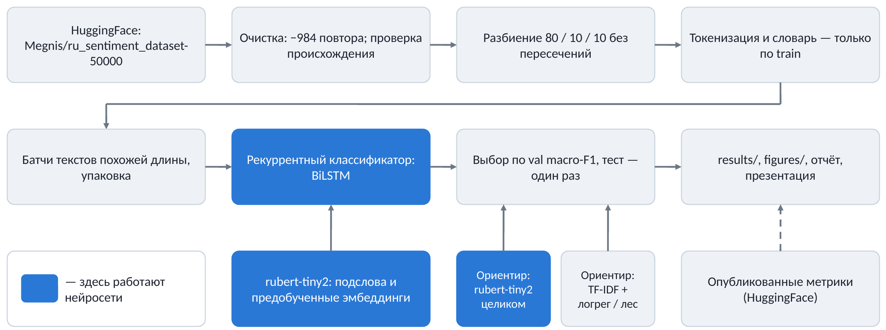
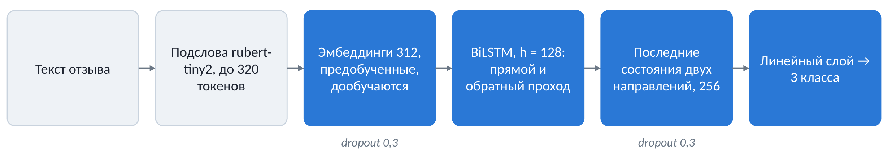
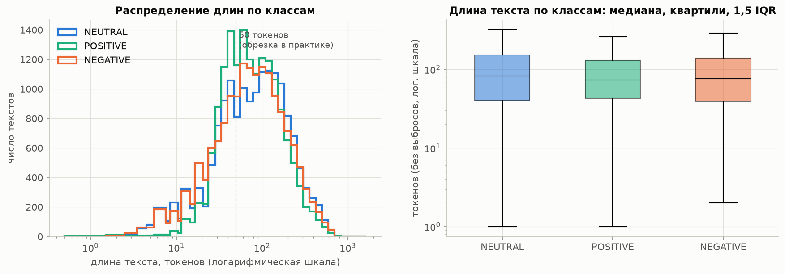
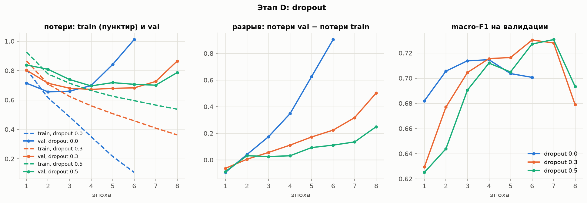
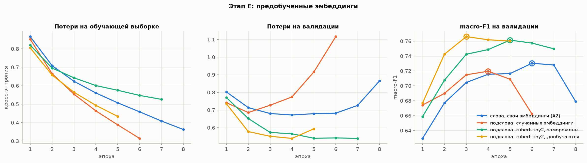
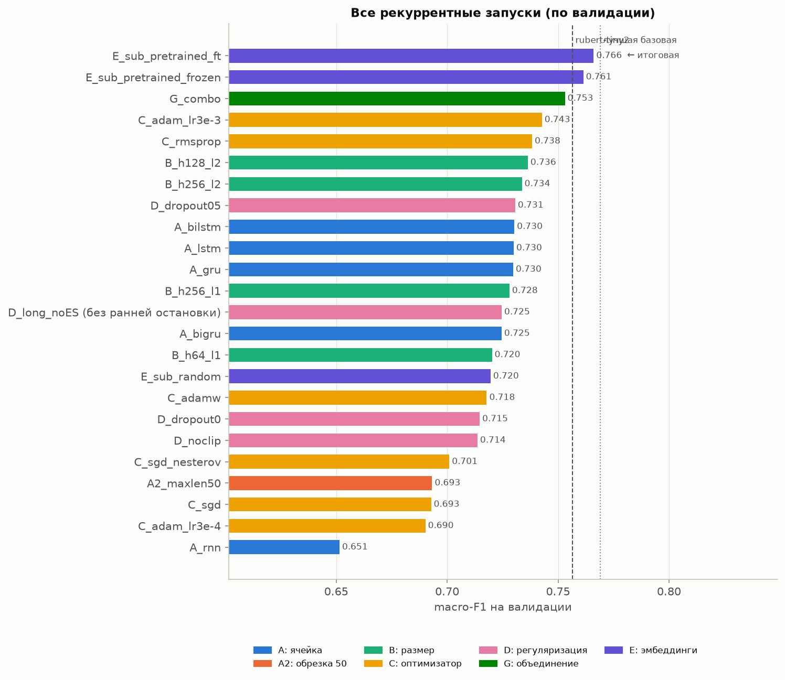
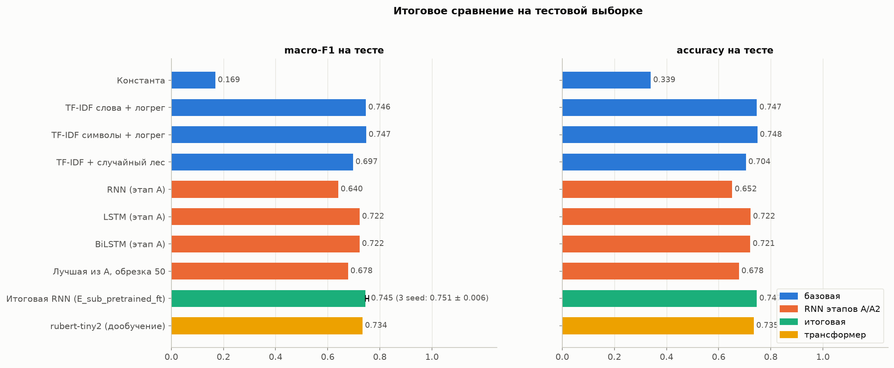
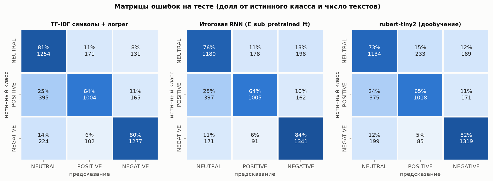
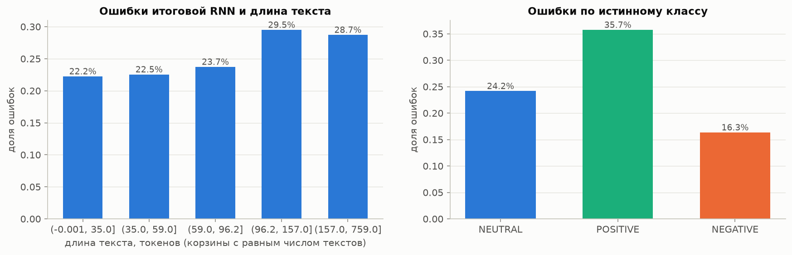
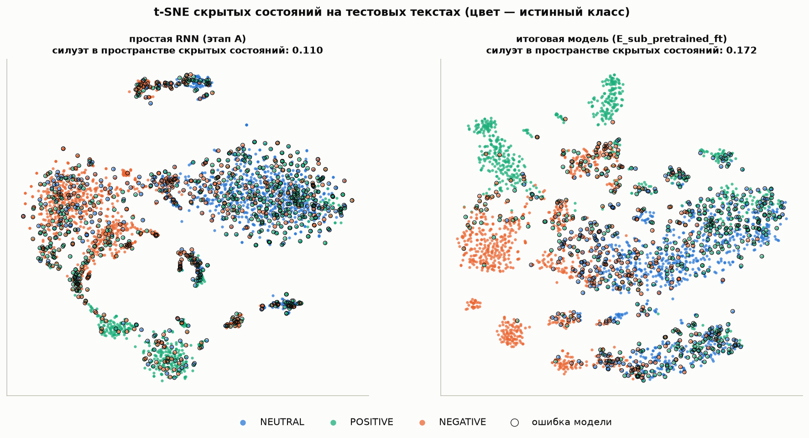

# 1. Описание проекта

## 1.1. Актуальность

Отзывы об отелях, клиниках, ресторанах, банках и других организациях — большой поток текста, который вручную не прочитать. Автоматическая оценка тональности (положительный, нейтральный или отрицательный отзыв) нужна, чтобы отслеживать качество сервиса, быстро находить жалобы и считать долю недовольных клиентов.

## 1.2. Проблема

Проект развивает вторую часть практики 10 «RNN, LSTM»: та же задача (тональность русскоязычных текстов, три класса), тот же набор данных `Megnis/ru_sentiment_dataset-50000` с HuggingFace, те же семейства моделей. В исходной постановке практики:

- словарь и обучающий набор строились по всему набору данных, включая будущие валидацию и тест, поэтому val accuracy 0,98–0,99 в сохранённом выводе практики не является оценкой качества (утечка данных);
- текст обрезался до 50 слов, хотя у двух третей текстов (66 %) длина больше, и конец, где часто стоит итоговая оценка автора, отбрасывался;
- дополнение нулями ставилось в конец, а итоговое состояние сети бралось после последнего шага, то есть после хвоста из `<PAD>`;
- модели сравнивались по одному запуску одной конфигурации, без базовых моделей и без оценки разброса.

Поэтому было неизвестно, какие решения действительно влияют на качество — тип ячейки, длина текста, размер сети, оптимизатор, регуляризация, предобученные эмбеддинги — и выигрывает ли рекуррентная сеть у простых методов.

## 1.3. Цель

Построить и обосновать рекуррентный классификатор тональности (нейтральный / позитивный / негативный) и экспериментально выяснить, какие решения влияют на качество.

## 1.4. Задачи

1. Описать данные (классы, длины текстов, повторы), очистить их и проверить происхождение набора.
2. Разбить данные на train / val / test (80 / 10 / 10) без пересечений; словарь строить только по train.
3. Получить базовые модели: константу, TF-IDF + логистическая регрессия, TF-IDF + случайный лес.
4. Сравнить RNN, LSTM, GRU, BiLSTM, BiGRU и длину обрезки текста.
5. Сравнить размер скрытого состояния, число слоёв и оптимизаторы.
6. Исследовать регуляризацию: dropout, обрезку градиента, раннюю остановку.
7. Применить перенос обучения: предобученные эмбеддинги и дообучение готовой сети `cointegrated/rubert-tiny2`.
8. Один раз оценить итоговую модель на тесте, разобрать ошибки, построить t-SNE скрытых состояний.
9. Сравнить результат с опубликованными метриками на HuggingFace.

# 2. Структура проекта и архитектура

## 2.1. Схема решения и потоки данных

{width=100%}

**Источники данных:**

- набор `Megnis/ru_sentiment_dataset-50000` (HuggingFace) — 48 212 текстов с метками;
- исходный набор `MonoHime/ru_sentiment_dataset` (HuggingFace) — только для проверки происхождения строк;
- готовая сеть `cointegrated/rubert-tiny2` (HuggingFace) — токенизатор, матрица эмбеддингов и сама модель для дообучения;
- карточки опубликованных моделей на HuggingFace — метрики для сравнения.

**Поток данных:** загрузка → очистка от повторов и проверка происхождения → разбиение 80 / 10 / 10 → токенизация и словарь только по train → батчи из текстов похожей длины с упаковкой последовательностей → рекуррентный классификатор → выбор конфигурации по val macro-F1 → однократная оценка на тесте → разбор ошибок и t-SNE.

**Где используются нейросети:**

1. рекуррентный классификатор (RNN / LSTM / GRU, одно- и двунаправленные) — основная модель проекта;
2. предобученные эмбеддинги подслов `rubert-tiny2` — вход итоговой рекуррентной сети;
3. дообучение `rubert-tiny2` целиком — ориентир для сравнения.

Базовые модели (TF-IDF + логистическая регрессия или случайный лес) нейросетями не являются и служат классическим ориентиром.

**Потребители результатов:** таблицы и журналы запусков (`results/`), графики (`figures/`), этот отчёт и презентация.

## 2.2. Состав кода

| файл | содержание |
|---|---|
| `project_rusentiment_rnn.ipynb` | тетрадка: все эксперименты, таблицы, графики и выводы (разделы 1–11) |
| `project_lib.py` | загрузка и очистка данных, разбиение, токенизация и словари, батчи, модель `RNNClassifier`, цикл обучения с ранней остановкой, журнал запусков `Runner`, дообучение трансформера |
| `results/` | таблицы (`*.csv`, `*.json`), истории обучения всех запусков (`runs/*.json`), журнал `progress.log` |
| `figures/` | 24 графика в PNG |

Запуски сохраняются в журнал по мере расчёта, поэтому прерванный расчёт продолжается с места остановки.

## 2.3. Архитектура итоговой сети

{width=100%}

- **Вход:** текст режется на подслова токенизатором `rubert-tiny2`, длина — до 320 подслов (медиана — 106 подслов, обрезается 9,9 % текстов).
- **Эмбеддинги:** размер 312, инициализированы предобученной матрицей `rubert-tiny2` и дообучаются вместе с сетью. В словарь входят 64 726 подслов, встретившихся в train (из 83 828 у модели); матрица масштабирована общим множителем до стандартного отклонения 1, как у случайной инициализации.
- **Рекуррентный слой:** BiLSTM, 1 слой, h = 128. Последовательности упакованы (`pack_padded_sequence`), поэтому итоговое состояние берётся после последнего настоящего токена, а не после дополнения нулями.
- **Выход:** последние состояния прямого и обратного направлений (вместе 256) → dropout 0,3 → линейный слой на 3 класса. Dropout 0,3 применяется и к эмбеддингам.
- **Инициализация:** ортогональные рекуррентные матрицы, смещение забывающего вентиля LSTM = 1.
- **Параметров:** 20,6 млн, из них 20,2 млн — эмбеддинги.

# 3. Используемый инструментарий

| инструмент | версия | для чего |
|---|---|---|
| Python | 3.13.7 | язык; Jupyter-тетрадка и модуль `project_lib.py` |
| PyTorch | 2.14.1 | RNN / LSTM / GRU, обучение на GPU Mac (MPS) |
| transformers, datasets | 5.19.0, 5.1.0 | набор данных и `rubert-tiny2` с HuggingFace, дообучение трансформера |
| scikit-learn | 1.9.1 | TF-IDF, логистическая регрессия, случайный лес, метрики, t-SNE, силуэт |
| pandas, numpy | 3.0.6, 2.3.5 | подготовка данных, таблицы результатов |
| matplotlib, seaborn | 3.11.2, 0.13.2 | графики |

Расчёт выполнен на Mac с Apple Silicon. Перед обучением проверено, что рекуррентные слои на MPS дают те же результаты, что и на CPU (максимальное расхождение состояний и градиентов — 2,4·10⁻⁷), и замерена скорость: шаг обучения BiLSTM (батч 128, длина 100) — 0,116 с на MPS против 0,158 с на CPU, поэтому всё обучение шло на MPS. Полный расчёт тетрадки занял 124 мин (26 обучений нейросетей, базовые модели, дообучение `rubert-tiny2`).

# 4. Обучение

## 4.1. Данные: сбор и подготовка

**Набор.** 48 212 текстов, классы сбалансированы: NEUTRAL — 16 054, POSITIVE — 16 000, NEGATIVE — 16 158. Судя по примерам, это отзывы об организациях и услугах, а также новости и комментарии из обсуждений.

**Происхождение.** Все 48 212 строк найдены в `MonoHime/ru_sentiment_dataset` (сплит `train`), у всех совпали и текст, и метка. Наш набор — сбалансированная подвыборка исходного, в котором классы не сбалансированы (положительных 47,8 %).

**Длина текстов.** Медиана — 73–82 токена в зависимости от класса, 95-й процентиль — 271–324, максимум — до 1 623 токенов. 66 % текстов длиннее 50 токенов.

{width=100%}

**Очистка.** После нормализации найдено 627 групп повторяющихся текстов:

- в 339 группах метки совпадают — оставлено по одной копии (удалено 369 строк);
- в 288 группах (615 строк) у одного текста разные метки — такие группы удалены целиком.

Осталось 47 228 текстов (−984). Повторы удалены до разбиения, поэтому один текст не может попасть и в обучение, и в тест; отсутствие пересечений между частями проверено.

**Разбиение** со стратификацией по классу: train / val / test — 37 782 / 4 723 / 4 723 текста.

**Токенизация и словарь** (только по train):

- для словной модели — регулярное выражение (слова, числа, «!», «?», скобочные смайлики — отдельными токенами); словарь — до 50 000 токенов, встретившихся хотя бы дважды; он покрывает 94,4 % вхождений токенов в train; неизвестных токенов в val — 6,4 %;
- длина обрезки для словной модели — 256 токенов (обрезается 7,4 % обучающих текстов);
- для итоговой модели — подслова `rubert-tiny2`, длина до 320 (обрезается 9,9 % текстов); неизвестных подслов в val — 0,15 %.

## 4.2. Готовая сеть: источник и характеристики

`cointegrated/rubert-tiny2` (HuggingFace) — компактный русскоязычный BERT: 29,2 млн параметров, размер эмбеддинга 312, словарь 83 828 подслов. В проекте она используется двумя способами:

1. **токенизатор и матрица входных эмбеддингов** — как вход BiLSTM (этап E); варианты: эмбеддинги заморожены или дообучаются;
2. **дообучение целиком** с классификационной головой — как ориентир (этап F). Гиперпараметры взяты из карточки опубликованной модели `Bektur756/rubert-tiny2-russian-sentiment`: 3 эпохи, длина 128 подслов, `lr = 2e-5`, батч 64, AdamW; эпоха выбирается по val macro-F1.

## 4.3. Процесс обучения и метрики

- **Функция потерь** — кросс-энтропия; батч 128, в батче тексты похожей длины.
- **До 8 эпох** с ранней остановкой: если 2 эпохи подряд нет роста val macro-F1, обучение прекращается и возвращаются веса лучшей эпохи.
- **Обрезка нормы градиента** — до 1.
- **Основная метрика — macro-F1 на валидации:** классы сбалансированы, а macro-F1 одинаково учитывает все три класса. Дополнительно считаются accuracy, precision, recall и F1 по классам, матрица ошибок; для скрытых состояний — коэффициент силуэта.
- **Тест используется один раз** — для итоговой модели и ориентиров, после того как все решения приняты по валидации.
- **Разброс:** итоговая конфигурация обучена с тремя seed (42, 43, 44).

## 4.4. Определение значений гиперпараметров

Гиперпараметры подбирались по этапам, каждый этап начинается с лучшей по валидации конфигурации предыдущего. Стартовая конфигурация: BiLSTM, эмбеддинги 128, h = 128, 1 слой, Adam `lr = 1e-3`, dropout 0,3, обрезка 256 токенов.

**Базовые модели** (val macro-F1): константа — 0,169; TF-IDF слов и биграмм + логистическая регрессия (`C = 2`) — 0,757; **TF-IDF символьных n-грамм + логистическая регрессия (`C = 0,5`) — 0,769**; TF-IDF + случайный лес — 0,710.

**Этап A — тип ячейки и двунаправленность.**

| модель | val macro-F1 | время эпохи |
|---|---|---|
| RNN | 0,652 | 14 с |
| GRU | 0,730 | 18 с |
| LSTM | 0,730 | 18 с |
| BiGRU | 0,725 | 25 с |
| BiLSTM | 0,730 | 26 с |

Вентили дают +8 п. п. к простой RNN. Двунаправленность при упакованных последовательностях не помогает (BiLSTM 0,7303 против LSTM 0,7300). Формально лучшая — BiLSTM.

**Этап A2 — обрезка до 50 токенов, как в практике:** 0,693 против 0,730 (−3,7 п. п.), хотя эпоха в 2,1 раза быстрее.

**Этап B — размер сети.** h = 64 / 128 / 256 при одном слое: 0,720 / 0,730 / 0,728; h = 128, 2 слоя — 0,736 (эпоха в 2,2 раза дольше); h = 256, 2 слоя — 0,734. Насыщение наступает на h = 128.

**Этап C — оптимизаторы.**

| оптимизатор | val macro-F1 |
|---|---|
| **Adam, lr = 3e-3** | **0,743** |
| RMSprop, lr = 1e-3 | 0,738 |
| Adam, lr = 1e-3 (база) | 0,730 |
| AdamW, lr = 1e-3, wd = 0,01 | 0,718 |
| SGD + Нестеров, lr = 0,05 | 0,701 |
| SGD, lr = 0,5 | 0,693 |
| Adam, lr = 3e-4 | 0,690 |

Адаптивные методы выигрывают у SGD 4–5 п. п.; у Adam результат сильно зависит от lr. Скорости обучения для SGD и RMSprop не подбирались.

**Этап D — регуляризация.**

- Dropout 0 / 0,3 / 0,5: 0,715 / 0,730 / 0,731; без dropout модель быстро запоминает обучающие тексты (разрыв val loss − train loss к 6-й эпохе около 0,9).
- Без обрезки градиента — 0,714 (с обрезкой 0,730); взрыва градиента нет, обрезка — страховка.
- Без ранней остановки (12 эпох) минимум val loss — на 3-й эпохе, дальше переобучение; ранняя остановка экономит время и не даёт взять переобученную модель.

{width=100%}

**Этап G — объединение лучших решений** (2 слоя, Adam 3e-3, dropout 0,5, обрезка градиента): **0,753**, +2,3 п. п. к базе, но эпоха 59 с вместо 26 с.

**Этап E — перенос обучения** (BiLSTM, h = 128, 1 слой, базовые настройки).

| вариант | val macro-F1 | время эпохи | обучаемых параметров |
|---|---|---|---|
| слова, свои эмбеддинги | 0,730 | 26 с | 6,66 млн |
| подслова, случайные эмбеддинги | 0,720 | 77 с | 20,6 млн |
| подслова, `rubert-tiny2` заморожены | 0,761 | 24 с | 0,45 млн |
| **подслова, `rubert-tiny2` дообучаются** | **0,766** | 75 с | 20,6 млн |

Сам подсловный токенизатор не помогает, весь выигрыш даёт предобучение: +3,1 п. п. у замороженных эмбеддингов и +3,6 п. п. у дообучаемых.

{width=100%}

**Этап F — `rubert-tiny2` целиком:** 0,757. Вероятные причины отставания: при длине 128 подслов у 43 % текстов отрезается конец, и за 3 эпохи модель, судя по кривым, не вышла на плато. Отдельно это не проверялось.

**Выбор итоговой модели.** Среди 23 конфигураций этапов A–G и E лучшая по валидации — `E_sub_pretrained_ft` (0,766). Копии с seed 43 и 44 дали 0,773 и 0,767: **0,769 ± 0,004**. Различия меньше ~0,007 по одному запуску неотличимы от шума.

{width=52%}

| гиперпараметр | значение итоговой модели |
|---|---|
| токенизация | подслова `rubert-tiny2`, до 320 |
| эмбеддинги | 312, предобученные, дообучаются |
| рекуррентный слой | BiLSTM, 1 слой, h = 128 |
| dropout | 0,3 |
| оптимизатор | Adam, `lr = 1e-3`, обрезка градиента 1 |
| обучение | батч 128, до 8 эпох, ранняя остановка (терпение 2) |
| выбранная эпоха | 3-я (seed 42), 75 с на эпоху |

# 5. Тестирование работы сети

## 5.1. Метрики на тесте

| модель | accuracy | macro-F1 |
|---|---|---|
| константа | 0,339 | 0,169 |
| TF-IDF слова + логрег | 0,747 | 0,746 |
| TF-IDF символы + логрег | 0,748 | 0,747 |
| TF-IDF + случайный лес | 0,704 | 0,697 |
| RNN (этап A) | 0,652 | 0,640 |
| LSTM (этап A) | 0,722 | 0,722 |
| BiLSTM (этап A) | 0,721 | 0,722 |
| BiLSTM, обрезка 50 токенов | 0,678 | 0,678 |
| итоговая RNN, seed 42 | 0,747 | 0,745 |
| **итоговая RNN, 3 seed** | **0,752 ± 0,005** | **0,751 ± 0,006** |
| `rubert-tiny2` (дообучение) | 0,735 | 0,734 |

- Итоговая модель на тесте: **macro-F1 0,751 ± 0,006**. Это на 2,9 п. п. лучше BiLSTM этапа A, на 7 п. п. лучше модели с обрезкой до 50 токенов, на 11 п. п. лучше простой RNN и на 1,1–1,7 п. п. лучше дообученной `rubert-tiny2`.
- Символьный TF-IDF с логистической регрессией (0,747) практически не уступает: разница меньше разброса по seed.
- Тест ниже валидации (0,751 против 0,769): модель выбрана как лучшая из 23 по валидации, и валидационная оценка, по-видимому, оптимистична.
- F1 по классам у итоговой модели: NEGATIVE — 0,812, NEUTRAL — 0,714, POSITIVE — 0,708. Тот же порядок у всех сильных моделей.

{width=100%}

## 5.2. Где ошибается модель

{width=100%}

- Самая частая ошибка — положительный текст отнесён к нейтральным: 25 % положительных текстов у RNN и TF-IDF, 24 % у `rubert-tiny2`. Это свойство данных, а не конкретной модели: граница между похвалой с оговорками и нейтральным отзывом размыта и в разметке.
- Длинные тексты даются хуже: 22–24 % ошибок у текстов до 96 токенов и 29–30 % у более длинных.
- По истинному классу: POSITIVE — 35,7 % ошибок, NEUTRAL — 24,2 %, NEGATIVE — 16,3 %.
- На 681 тексте (14,4 % теста) ошибаются все три сильные модели.

{width=100%}

## 5.3. Примеры проблемных данных и корректных результатов

**Проблемные:**

- метка POSITIVE, модель NEGATIVE (p = 1,00): «Не водите своего ребёнка к педиатру… не лечит, а калечит» — похоже на ошибку разметки;
- метка NEGATIVE, модель POSITIVE (p = 1,00): «ОГРОМНОЕ СПАСИБО за нашего сына…» — тоже ошибка разметки;
- метка NEUTRAL, модель NEGATIVE: новостная заметка о гибели ребёнка — тон новости нейтральный, тема негативная; исходный набор объединяет отзывы, новости и комментарии, и правила разметки в них, по-видимому, различались;
- среди текстов, на которых ошибаются все модели, — восторженные отзывы об отелях, размеченные как NEUTRAL, и ироничные реплики из обсуждений.

**Корректные** (уверенно и верно):

- благодарности врачам — POSITIVE, p = 1,00;
- жалобы на отношение и некомпетентность — NEGATIVE, p = 1,00;
- взвешенные отзывы об отелях с плюсами и минусами — NEUTRAL, p ≈ 0,95.

**Проверка на собственных фразах** (иллюстрация, а не метрика): явный позитив, явный негатив и нейтральное описание гостиницы итоговая RNN классифицирует верно (p = 0,97 / 0,99 / 0,93). Иронию «Ну спасибо за „прекрасный“ сервис: ждали заказ два часа» RNN отнесла к NEGATIVE неуверенно (0,60), а `rubert-tiny2` — к POSITIVE (0,45). Фразу со сменой тона обе модели отнесли к NEUTRAL, что согласуется с разметкой набора.

## 5.4. Скрытые состояния (t-SNE)

{width=100%}

Коэффициент силуэта в пространстве скрытых состояний — 0,110 у простой RNN и 0,172 у итоговой модели. Отрицательные и положительные тексты образуют компактные группы, нейтральные занимают центр и смешиваются с обоими классами; ошибки сосредоточены в зонах перемешивания. Такие тексты — первые кандидаты на проверку разметки.

## 5.5. Сравнение с опубликованными результатами

| модель | данные и тест | macro-F1 |
|---|---|---|
| `Bektur756/rubert-tiny2-russian-sentiment` | исходный набор MonoHime, 180 853 обучающих текста, их тест | 0,777 |
| итоговая RNN (проект) | 37 782 обучающих текста, наш тест | 0,751 ± 0,006 |
| TF-IDF символы + логрег (проект) | наш тест | 0,747 |
| `rubert-tiny2` по тому же рецепту (проект) | наш тест | 0,734 |

- Для самого набора `Megnis/ru_sentiment_dataset-50000` опубликованных метрик нет; ближайший ориентир — модель, дообученная на исходном наборе.
- У неё в 4,8 раза больше обучающих текстов и другой, несбалансированный тест, поэтому сравнение macro-F1 ориентировочное, а accuracy сравнивать нельзя. Распределение качества по классам такое же: лучше всего распознаётся NEGATIVE.
- Все наши строки взяты из train исходного набора, поэтому опубликованные модели, по-видимому, видели наши тексты при обучении, и проверять их на нашем тесте нельзя. Для прямого сравнения та же архитектура дообучена заново на нашем train.
- Val accuracy 0,99 из практики 10 — следствие утечки; та же BiLSTM без утечки даёт на тесте 0,722.

# 6. Заключение

Цель достигнута: построен и обоснован рекуррентный классификатор тональности. Итоговая модель — BiLSTM на подсловах с дообучаемыми эмбеддингами `rubert-tiny2`: на тесте **macro-F1 0,751 ± 0,006, accuracy 0,752 ± 0,005** (3 seed).

**Что действительно влияет на качество** (по валидации): вентили (+8 п. п.), длина обрезки 256 вместо 50 (+3,7 п. п.), предобученные эмбеддинги (+3–4 п. п.), оптимизатор и скорость обучения (до 5 п. п.), объединение лучших решений (+2,3 п. п.), dropout (+1,5 п. п.). Двунаправленность, размер скрытого состояния больше 128, второй слой и обрезка градиента дают различия на уровне шума.

**Ответы на вопросы практики:**

1. двунаправленная сеть при упакованных последовательностях не лучше однонаправленной;
2. на t-SNE кластеры видны частично: отрицательный класс отделяется лучше всего, положительный и нейтральный пересекаются;
3. рост скрытого состояния и числа слоёв почти не помогает, а время эпохи растёт в 2–3,5 раза.

**Ограничения:**

- каждая конфигурация, кроме итоговой, обучена один раз;
- скорости обучения для SGD и RMSprop не подбирались;
- вычисления на MPS не полностью воспроизводимы;
- в разметке заметный шум и, по-видимому, разные правила для разных источников; символьный TF-IDF на этих данных не уступает нейросети.

**Что можно сделать дальше:** обучить на всём исходном наборе (в 4–5 раз больше текстов), почистить разметку по уверенным ошибкам, дообучить трансформер с длиной входа больше 128 и большим числом эпох, объединить RNN и TF-IDF в ансамбль (модели ошибаются по-разному).

# Приложение. Воспроизведение

```bash
python3 -m venv .venv && source .venv/bin/activate
pip install -r requirements.txt
MPLBACKEND=Agg PYTORCH_ENABLE_MPS_FALLBACK=1 \
  jupyter nbconvert --to notebook --execute --inplace \
  --ExecutePreprocessor.timeout=-1 project_rusentiment_rnn.ipynb
```

Нужен интернет (набор данных и `rubert-tiny2` скачиваются с HuggingFace). Ход расчёта — в `results/progress.log`, итоговые метрики — в `results/final_test.csv`.
